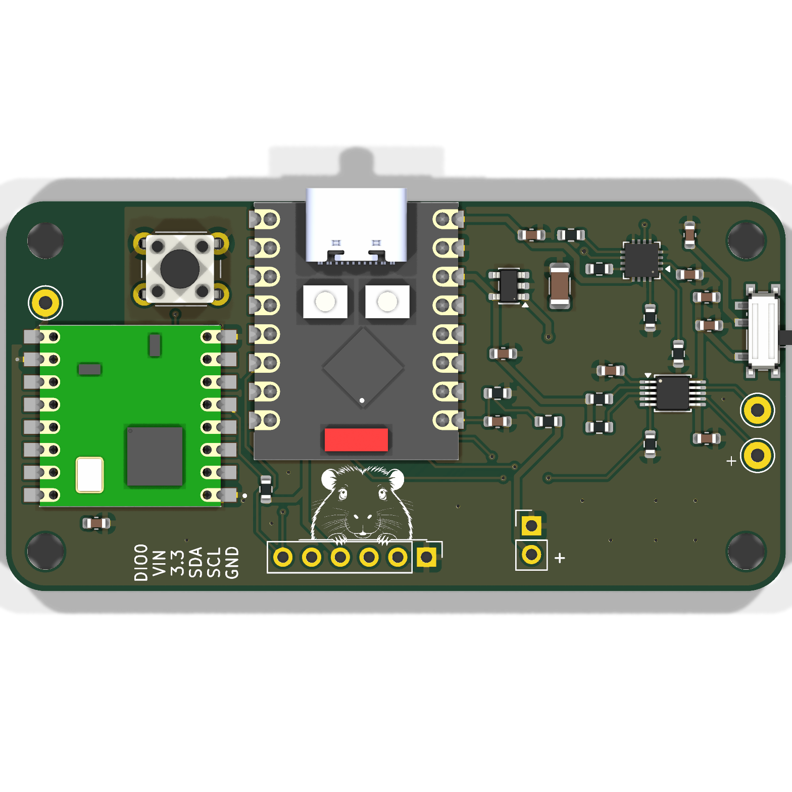
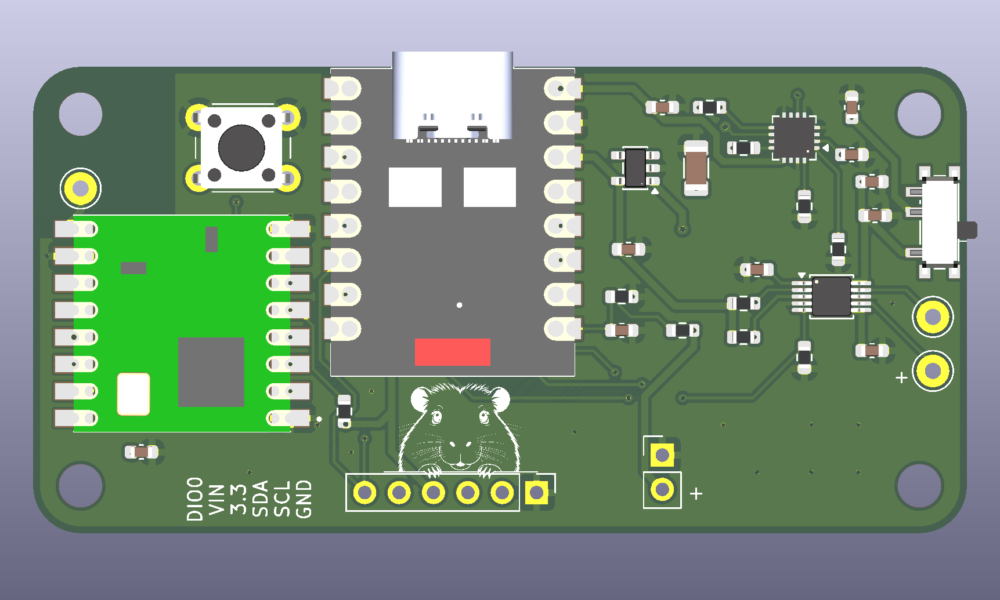

<div align="center">

# lora-ch1

**Off-Grid 433 MHz LoRa–BLE Peer-to-Peer Communicator Based on ESP32-C3 & FreeRTOS**

[](https://www.espressif.com/)
[](#hardware-architecture--specifications)
[](#firmware-architecture--key-features)
[](https://platformio.org/)
[](#license)

<br>



*Raytraced 3D render of the **lora-ch1** custom PCB featuring ESP32-C3, 433 MHz RFM98W LoRa transceiver, DRV2605L haptics, and BQ24075 charger*

</div>

---

## Overview

**lora-ch1** is a compact, battery-powered hardware bridge and embedded firmware stack that enables **long-range, internet-independent messaging** between mobile devices.

Each node pairs with a smartphone over **Bluetooth Low Energy (BLE)** and transparently relays fragmented text messages, End-to-End Encryption (E2EE) public keys, neighbor heartbeats, and optional GPS coordinates over **433 MHz LoRa (RFM98W / SX1278)**—with zero cellular or Wi-Fi infrastructure required.

```text
[ Mobile App ] <--- BLE GATT (512 B MTU) ---> [ ESP32-C3 (FreeRTOS) ] <--- SPI ---> [ RFM98W 433 MHz ] ))) LoRa ((( [ Peer Nodes ]
```

Key use cases include:
* Off-grid hiking, festivals, and remote areas without cellular coverage
* Resilient peer-to-peer (P2P) and broadcast emergency communication
* Decentralized local node discovery with RSSI tracking and privacy-aware GPS sharing
* Hardware-assisted E2EE key exchange using reliable LoRa ARQ delivery

<details>
<summary><b>View Top & Isometric 3D PCB Renders</b></summary>
<br>

| Top View (`F.Cu`) | Isometric 3D View |
| :---: | :---: |
|  |  |

</details>

---

## Hardware Architecture & Specifications

| Subsystem | Components & Specifications |
| :--- | :--- |
| **MCU & BLE** | **ESP32-C3** — 32-bit RISC-V microcontroller running thread-safe **FreeRTOS** firmware (`esp32-c3-devkitm-1` target), BLE 5 GATT server |
| **LoRa Transceiver** | **RFM98W / SX1278** (433 MHz ISM band) connected via SPI + dual hardware interrupts (`DIO0`, `DIO1`) and reset (`RST`) |
| **Haptic Feedback** | **DRV2605L** I2C haptic motor driver with dedicated hardware enable (`DRV_EN`) for tactile message, button, alert, and low-battery cues |
| **Power & Charging** | **BQ24075** Li-Ion/Li-Po battery charger with open-drain charging status output (`CHRG`, active-low) and ADC battery voltage sensing (`BAT_SENS`, `ADC_11db`) |
| **User Interface** | Hardware push button (`BUTTON`) with software debouncing for wake-up and 60-second BLE pairing authorization |

---

## ESP32-C3 GPIO Mapping

| Subsystem | Signal | ESP32-C3 GPIO | Description |
| :--- | :--- | :---: | :--- |
| **LoRa (SPI)** | `SCK` | `GPIO 4` | SPI Clock |
| | `MISO` | `GPIO 5` | Master In Slave Out |
| | `MOSI` | `GPIO 6` | Master Out Slave In |
| | `NSS` | `GPIO 7` | Chip Select (`CS`) |
| | `RST` | `GPIO 2` | LoRa Hardware Reset |
| | `DIO0` | `GPIO 10` | LoRa IRQ / Interrupt 0 |
| | `DIO1` | `GPIO 3` | LoRa IRQ / Interrupt 1 |
| **I2C Bus** | `SDA` | `GPIO 8` | I2C Data (`DRV2605L`) |
| | `SCL` | `GPIO 9` | I2C Clock (`DRV2605L`) |
| **Haptic Driver** | `DRV_EN` | `GPIO 21` | `DRV2605L` Enable pin |
| **Power / Battery** | `CHRG` | `GPIO 20` | `BQ24075` charging status (`LOW` = charging) |
| | `BAT_SENS` | `GPIO 1` | Battery voltage ADC (`ADC_11db` attenuation) |
| **User Input** | `BUTTON` | `GPIO 0` | Hardware button (debounced) |

---

## Firmware Architecture & Key Features

* **Thread-Safe FreeRTOS Architecture:** Decouples BLE GATT handling and LoRa radio operations across concurrent tasks, preventing bus contention and dropped packets.
* **Fast TX & Continuous RX:** Uses an optimized 12-symbol preamble to reduce Time on Air (ToA) to **~100–132 ms** (payload-dependent), minimizing collisions while keeping continuous background RX active.
* **Reliable P2P Delivery (ARQ) & Broadcasts:** Supports both public broadcasts (`FFFFFFFF`) and addressed P2P messages. P2P packets use hardware ACK with up to **3 automatic retries** and a **dynamic ACK timeout** computed from payload ToA and the mandatory 10% duty-cycle off-time.
* **EU 433 MHz Duty-Cycle Monitoring:** Tracks cumulative Time on Air (ToA) and real-time duty-cycle percentage to stay compliant with the European **10% duty-cycle limit** on 433 MHz.
* **End-to-End Encryption (E2EE) Key Routing:** Natively transports public key handshakes (`KEY_REQ` / `KEY_RESP`) over the LoRa ARQ layer for verified peer key delivery.
* **Offline P2P Message Buffer:** Buffers up to **32 incoming P2P messages** in RAM while the phone is disconnected and flushes them immediately upon BLE reconnection (public broadcasts are excluded to preserve RAM).
* **Smart Neighbor Discovery & Privacy Mode:** Periodic heartbeats advertise node identity, RSSI, last-seen timestamp, custom RGB UI color, and GPS coordinates, automatically pruning stale/out-of-range nodes. Disabling location (`NO_LOC`) dynamically truncates the binary heartbeat payload by **8 bytes** to save airtime and battery.
* **Physical-Presence BLE Security:** BLE advertising is hidden by default (`Just Works`). Pressing the hardware button opens a **60-second Pairing Mode** window to block unauthorized connections.
* **Dynamic NVS Persistence:** Generates unique Version 4 BLE UUIDs, device name (`lora-ch1-XXXX`), and hardware-derived LoRa ID on first boot, storing all user settings persistently in Non-Volatile Storage (NVS).
* **Battery Telemetry & Haptics:** Reads real battery percentage via ADC and charging state via `BQ24075`, triggering distinct `DRV2605L` haptic patterns for button presses, incoming messages, locate alerts (`FIND`), and low-battery warnings (<15% while discharging).

### Power Management Profiles

| Profile | CPU Frequency | Heartbeat Interval | Behavior |
| :--- | :---: | :---: | :--- |
| **`BATTERY_SAVER`** *(default on boot)* | 80 MHz | 10 min | Lowest power baseline; pressing `BUTTON` temporarily wakes the node to `BALANCED` for BLE interaction. |
| **`BALANCED`** | 80 / 160 MHz | 5 min | Standard active profile for regular messaging and neighbor updates. |
| **`PERFORMANCE`** | 160 MHz | 1 min | Fastest neighbor discovery and responsiveness at higher battery consumption. |

---

## BLE GATT API Reference

The device exposes **one main BLE Service** containing **two Characteristics** (**Data** and **Control**). Both characteristics support `READ`, `WRITE`, and `NOTIFY`, and all text payloads use **semicolon (`;`) delimiters**.

### Connection Requirements

* **Android MTU (Critical):** Android clients **must** call `requestMtu(512)` immediately after connecting; otherwise, Android truncates incoming notifications to 20 bytes. *(iOS negotiates MTU automatically.)*
* **Advertising Name:** `lora-ch1-XXXX`, where `XXXX` is the last 2 bytes of the device MAC address (e.g., `lora-ch1-A1B2`).
* **Dynamic UUIDs:** Service and characteristic UUIDs are randomly generated (UUID v4) on first boot and persisted in NVS. Clients **must use BLE Service Discovery** instead of hardcoded UUIDs.
* **Pairing Window:** Advertising is disabled by default. Press the physical button to enable visibility for **60 seconds**.

### A. Data Characteristic (`App <-> LoRa`)

#### Sending (`App -> ESP32`, via `WRITE`)
| Format | Payload Structure | Notes & Example |
| :--- | :--- | :--- |
| **Standard Message** | `TARGET_MAC;CURRENT_FRAGMENT;TOTAL_FRAGMENTS;PAYLOAD` | `TARGET_MAC` is an 8-char HEX LoRa ID (`FFFFFFFF` for Broadcast). Keep `PAYLOAD` ≤ ~240 bytes per write.<br>*Broadcast:* `FFFFFFFF;1;1;Hello everyone!`<br>*Fragmented P2P:* `ABCD1234;1;3;This is a long me` |
| **Key Exchange** | `KEY_REQ;TARGET_MAC;PUBLIC_KEY`<br>`KEY_RESP;TARGET_MAC;PUBLIC_KEY` | Forwards E2EE public keys via LoRa ARQ with hardware ACK.<br>*Example:* `KEY_REQ;A1B2C3D4;PU8r8H3BvjiyDNbqtp12Y1LHFvhF+nJI81oWjmFqS1w=` |

#### Receiving (`ESP32 -> App`, via `NOTIFY`)
| Event | Notification Structure | Notes |
| :--- | :--- | :--- |
| **Incoming Message** | `SENDER_MAC;SENDER_USERNAME;COLOR_HEX;TARGET_MAC;CURRENT_FRAGMENT;TOTAL_FRAGMENTS;TIMESTAMP;RSSI;PAYLOAD` | `TARGET_MAC` distinguishes Broadcast (`FFFFFFFF`) from P2P. `SENDER_USERNAME` (`Unknown`) and `COLOR_HEX` (`0088FF`) resolve from the neighbor cache. All fragments of a multi-part message share the first fragment's UNIX `TIMESTAMP` (`0` if unsynced). `RSSI` in dBm (e.g., `-78.00`). |
| **Delivery ACK** | `ACK_OK;TARGET_MAC` | Receiver hardware acknowledged the P2P message or Key Exchange. |
| **Delivery Timeout** | `ERR_TIMEOUT;TARGET_MAC` | P2P delivery failed after maximum retries or channel collisions. |
| **Key Exchange** | `KEY_REQ;SENDER_MAC;PUBLIC_KEY`<br>`KEY_RESP;SENDER_MAC;PUBLIC_KEY` | Incoming E2EE key exchange request or response from a peer. |

### B. Control Characteristic (`App <-> ESP32`)

Commands are sent via `WRITE` and answered asynchronously via `NOTIFY`:

| Command (`App -> ESP32`) | Response (`NOTIFY`) | Description |
| :--- | :--- | :--- |
| `SET_TIM;UnixSeconds` | `TIM_OK` | Syncs internal RTC to UNIX epoch time (e.g., `SET_TIM;1715423000`). Send immediately upon connect. |
| `SET_LOC;Latitude;Longitude` | `LOC_OK` / `LOC_ERR` | Updates cached GPS coordinates for LoRa heartbeats (e.g., `SET_LOC;47.5316;21.6273`). |
| `GET_LOC` | `LOC;Latitude;Longitude` | Returns stored coordinates (e.g., `LOC;47.531600;21.627300`). |
| `NO_LOC` | `NO_LOC_OK` | Enables Privacy Mode: resets coordinates to `0.0` and truncates heartbeat payload by 8 bytes. |
| `GET_NEI` | `NEI\|MAC;USR;COL;RSSI;TS;LAT;LON\|...` or `NEI\|NO_NEI` | Returns active neighbor list (`\|`-delimited entries, `;`-delimited fields). |
| `GET_BAT` | `BAT;Percentage;IsCharging` | Returns battery level and charging flag (`1` = charging, `0` = discharging; e.g., `BAT;87;1`). |
| `SET_USR;Username` | `USR_OK` | Saves username to NVS (disallows `;` and `\|`, trims whitespace; defaults to `Guest`). |
| `GET_USR` | `USR;Username` | Returns stored username (default: `Guest`). |
| `SET_COL;HexColor` | `COL_OK` | Saves 6-char RGB HEX UI color to NVS (e.g., `FF0000`; invalid values fall back to `0088FF`). |
| `GET_COL` | `COL;HexColor` | Returns stored UI color HEX string (default: `0088FF`). |
| `SET_PWR;ProfileName` | `PWR_OK` / `PWR_ERR` | Switches power profile (`BATTERY_SAVER`, `BALANCED`, `PERFORMANCE`). |
| `GET_VIB` | `VIB;{0/1}` | Queries haptic feedback state (`0` = off, `1` = on). |
| `SET_VIB;STATUS` | `VIB_OK` | Enables (`1`, default) or disables (`0`) haptic feedback. |
| `GET_ID` | `ID;LOCAL_ID` | Returns the node's 8-char HEX LoRa address (e.g., `ID;3FFE78C0`). |
| `FIND` | `FIND_OK` | Triggers 5 seconds of continuous 750 ms 100% alert haptic pulses to locate the device. |
| `RST` | `RST_OK` | Reboots the ESP32-C3 (BLE reconnection required). |
| `FACTORY_RESET` | `FACTORY_RESET_OK` | Wipes NVS (username, color, UUIDs, settings) and reboots. Hardware-derived LoRa MAC is preserved. |

---

## Important Notes & Integration Checklist

1. **Always sync time on connect:** Send `SET_TIM;<unix_epoch>` right after BLE connection so incoming and fragmented messages receive valid timestamps instead of `0`.
2. **Respect the 240-byte payload ceiling:** Fragment longer messages in the client app using `CURRENT_FRAGMENT;TOTAL_FRAGMENTS` to stay within LoRa packet and airtime limits.
3. **Sync MTU before subscribing/writing on Android:** Request `MTU = 512` before expecting full `GET_NEI` or standard data notifications.
4. **433 MHz antenna precaution:** Never power on or transmit with the `RFM98W` without a properly matched 433 MHz antenna connected to avoid damaging the RF power amplifier.

---

## Build & Flashing

The firmware is built with **PlatformIO** targeting the **`esp32-c3-devkitm-1`** board definition:

```bash
# Clone the repository
git clone [https://github.com/0x000f1/lora-ch1.git](https://github.com/0x000f1/lora-ch1.git)
cd lora-ch1

# Build firmware
pio run

# Flash to ESP32-C3 and open serial monitor
pio run -t upload -t monitor
```

---

## License

Licensed under the **MIT License**.
